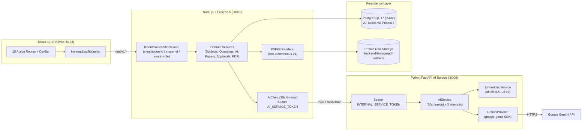

# Paper Distribution System — Initial Requirements vs. Implementation Audit

**Audit Date**: 2026-10-28  
**Project Title**: AI-Powered Blockchain-Based Secure Examination Infrastructure for Intelligent Question Paper Generation and Distribution  
**Audit Scope**: Evidence-based audit of the current repository (`frontend/`, `backend/`, `ai-service/`, `backend/prisma/`, `docs/`) against the intended functional, architectural, and security requirements.  
**Audit Mode**: Read-only / Audit-only (no application behavior, database schema, or configuration values were modified during this audit).

---

## 1. Executive Summary

The repository currently represents a **partially integrated multi-service prototype** with strong backend domain modeling for academic structure, question revisions, examination paper construction, deterministic validation, immutable version snapshots, approval workflow state transitions, and CBIT college-template PDF rendering, paired with a working Python FastAPI AI microservice (`ai-service`) and PostgreSQL 17 database (`pds_db`).

However, when evaluated against the complete intended requirements for a production-grade or fully dynamic academic examination platform, **five major architectural and functional gaps** stand out:

1. **No Real Authentication or User/Membership Management (`NOT IMPLEMENTED`)**:
   - The UI displays a static `<Badge tone="neutral">Not signed in</Badge>` in [`Header.tsx`](file:///c:/paper-distribution-system/frontend/src/components/layout/Header.tsx#L83) and relies on a development-only banner ([`DevBar.tsx`](file:///c:/paper-distribution-system/frontend/src/components/layout/DevBar.tsx)) that sets `localStorage` keys (`pds_dev_user_id`, `pds_dev_user_role`) and sends unverified HTTP headers (`x-institution-id`, `x-user-id`, `x-user-role`).
   - Backend [`tenantContext.ts`](file:///c:/paper-distribution-system/backend/src/middleware/tenantContext.ts#L44-L50) trusts these client headers in `development`/`test` and hard-blocks all `/api/v1` requests with `401` when `NODE_ENV === "production"`.
   - The sidebar entry **"Users & Memberships"** and **"Settings"** are hardcoded as `status: 'planned'` ("Soon") in [`navigation.ts`](file:///c:/paper-distribution-system/frontend/src/config/navigation.ts#L53-L54).

2. **Faculty Source-Document Upload & Ingestion Pipeline is Completely Missing (`NOT IMPLEMENTED`)**:
   - **"Source Documents"** is marked `status: 'planned'` ("Soon") in [`navigation.ts`](file:///c:/paper-distribution-system/frontend/src/config/navigation.ts#L41).
   - There are **zero** Prisma models, database tables, backend routes, file upload middlewares (`multer`/`busboy`), PDF/DOCX/TXT text-extraction libraries, or UI pages for uploading syllabus documents, textbooks, or lecture notes, nor for passing extracted source text into AI question generation or tracing generated questions back to source documents. Only a free-text `contextHint` (`max 500 chars`) exists on `QuestionGenerationJob`.

3. **AI Generator Timeout ("AI service request timed out") & Token-Limit Truncation Risks (`PARTIAL / DEFECTIVE UNDER LOAD`)**:
   - The exact message `"AI service request timed out"` originates in [`backend/src/services/aiClient.ts`](file:///c:/paper-distribution-system/backend/src/services/aiClient.ts#L152) where `AIClient` enforces a hard `AbortSignal.timeout(35_000)` (**35 seconds**).
   - Meanwhile, the Python AI service ([`ai-service/app/core/config.py`](file:///c:/paper-distribution-system/ai-service/app/core/config.py#L53-L57) and [`ai_service.py`](file:///c:/paper-distribution-system/ai-service/app/services/ai_service.py#L507-L567)) configures `ai_request_timeout_seconds = 30.0` with `ai_max_retries = 2` (up to **3 attempts × 32s + backoff = ~98 seconds**), plus sequential model fallback inside [`gemini.py`](file:///c:/paper-distribution-system/ai-service/app/providers/gemini.py#L140-L176). Whenever the primary model (`gemini-3.8-flash`) experiences Google API congestion (`503 UNAVAILABLE`) or slow multi-question generation, the Python service's retry/fallback window exceeds the Node.js backend's 35-second cutoff, causing `AIClient` to abort and persist the job as `FAILED` with `"AI service request timed out"`.
   - Additionally, `ai_max_output_tokens = 2048` in [`config.py`](file:///c:/paper-distribution-system/ai-service/app/core/config.py#L57) is too small for generating larger batches (e.g., 8–20 `LONG_ANSWER` or `MULTIPLE_CHOICE` questions with explanations), causing Gemini to truncate JSON mid-string and fail schema validation (`502 PROVIDER_INVALID_OUTPUT`).

4. **Incomplete First-Class Multiple-Choice (MCQ) Data Model & Static Theory-Paper PDF Coupling (`PARTIAL`)**:
   - While `QuestionType.MULTIPLE_CHOICE` exists in [`schema.prisma`](file:///c:/paper-distribution-system/backend/prisma/schema.prisma#L172), neither `QuestionRevision` nor `GeneratedQuestion` has structured columns/JSON for `options` (`A, B, C, D`) or `correctOption`. Instead, the AI prompt in [`ai_service.py`](file:///c:/paper-distribution-system/ai-service/app/services/ai_service.py#L93-L94) instructs Gemini to embed the 4 options as raw text inside `question_text`.
   - The PDF renderer ([`pdfRendererService.ts`](file:///c:/paper-distribution-system/backend/src/services/pdfRendererService.ts#L300-L413)) is tightly coupled to CBIT's two-part theory format (`!isPartB` straight numbered list vs. `isPartB` automatic 2-subpart `(a)/(b)` pairing with alternating `(OR)` separators and `M | CO | BT` columns). It does not dynamically adapt its layout for MCQ-only papers, mixed objective/descriptive sections, or arbitrary sub-question structures without forcing `Part - B` pairing heuristics.

5. **Database-Level Row-Level Security (RLS) & Blockchain Distribution (`NOT IMPLEMENTED / DEFERRED`)**:
   - Tenant isolation is enforced in application service queries (`where: { institutionId }`), but PostgreSQL Row-Level Security (RLS) policies are not created in any migration, and the app connects as the database superuser/owner (`pds_dev`).
   - Blockchain integrity anchoring and examination-center distribution are not implemented (intentionally deferred beyond Review 1).

---

## 2. Requirements Matrix

| ID | Requirement | Current Status | Evidence in Repository | Verified Behavior | Gap or Failure | Priority |
| :--- | :--- | :--- | :--- | :--- | :--- | :--- |
| **A1** | Real user sign-in, sign-out, and persistent authenticated session | `MISSING` | [`Header.tsx`](file:///c:/paper-distribution-system/frontend/src/components/layout/Header.tsx#L83), [`tenantContext.ts`](file:///c:/paper-distribution-system/backend/src/middleware/tenantContext.ts#L41-L77) | UI hardcodes `<Badge>Not signed in</Badge>`. No `/login` page, no `/api/v1/auth/*` routes, no JWT/session cookies, no `bcrypt` library installed in `backend/package.json`. | Users cannot sign in or sign out; identity is simulated via `localStorage` and HTTP headers. | **P0** |
| **A2** | Backend verification of authenticated identity & institution membership | `MISSING` | [`tenantContext.ts`](file:///c:/paper-distribution-system/backend/src/middleware/tenantContext.ts#L52-L75) | Backend accepts any valid UUID in `x-institution-id` and any string in `x-user-id` / `x-user-role` without querying `User` or `InstitutionMembership` in DB. Fails closed (`401`) when `NODE_ENV=production`. | Any client in dev mode can spoof any institution UUID, user ID, or role header without membership verification. | **P0** |
| **A3** | Server-side role authorization & separation of duties (Faculty vs. Reviewer) | `PARTIAL` | [`paperApprovalService.ts`](file:///c:/paper-distribution-system/backend/src/services/paperApprovalService.ts), [`approvals.ts`](file:///c:/paper-distribution-system/backend/src/routes/approvals.ts#L40-L51) | `reviewSubmission` checks `role` (`MODERATOR`/`ADMIN`/`INSTITUTION_ADMIN`) and blocks `submittedBy === reviewerId` (`403`). However, `role` and `reviewerId` come from unauthenticated `x-user-id`/`x-user-role` headers (or fallback to `DEFAULT_DEV_REVIEWER_ID`). | Business logic for separation of duties works and is tested, but can be bypassed via header switching in `DevBar` because real auth is missing. | **P0** |
| **A4** | Users & Memberships management UI and API | `MISSING` | [`navigation.ts`](file:///c:/paper-distribution-system/frontend/src/config/navigation.ts#L53) | Sidebar item `Users & Memberships` has `status: 'planned'` ("Soon"). `User` and `InstitutionMembership` tables exist in Prisma, but zero CRUD endpoints or UI pages exist. | Cannot invite/create users, assign roles (`EXAMINER`, `MODERATOR`, `INSTITUTION_ADMIN`), or revoke memberships from the app. | **P1** |
| **B1** | Subject & syllabus-topic CRUD management | `IMPLEMENTED & TESTED` | [`subjectService.ts`](file:///c:/paper-distribution-system/backend/src/services/subjectService.ts), [`topicService.ts`](file:///c:/paper-distribution-system/backend/src/services/topicService.ts), [`SubjectsPage.tsx`](file:///c:/paper-distribution-system/frontend/src/pages/SubjectsPage.tsx), [`SubjectDetailPage.tsx`](file:///c:/paper-distribution-system/frontend/src/pages/SubjectDetailPage.tsx) | Full create, list, filter, edit, archive (`ACTIVE`/`ARCHIVED`), and sequence ordering persisted in PostgreSQL (`subjects`, `topics`). | Works end-to-end. | — |
| **B2** | Question bank CRUD, immutable revisions, and optimistic concurrency | `IMPLEMENTED & TESTED` | [`questionService.ts`](file:///c:/paper-distribution-system/backend/src/services/questionService.ts), [`QuestionBankPage.tsx`](file:///c:/paper-distribution-system/frontend/src/pages/QuestionBankPage.tsx), [`QuestionEditorPage.tsx`](file:///c:/paper-distribution-system/frontend/src/pages/QuestionEditorPage.tsx), [`QuestionRevisionsPage.tsx`](file:///c:/paper-distribution-system/frontend/src/pages/QuestionRevisionsPage.tsx) | Creating a question creates `Question` + `QuestionRevision` (`v1`) atomically. Editing inserts `v2` and checks `expectedRevisionNumber` (`409 Conflict` on mismatch). | Structured MCQ options/answer key fields are missing on `QuestionRevision` (options are plain text inside `questionText`). | **P1** |
| **C1** | Faculty source-document upload, storage, text extraction, and AI context linkage | `MISSING` | [`navigation.ts`](file:///c:/paper-distribution-system/frontend/src/config/navigation.ts#L41), [`schema.prisma`](file:///c:/paper-distribution-system/backend/prisma/schema.prisma) | Sidebar item `Source Documents` is marked `Soon` (`status: 'planned'`). No Prisma models, upload endpoints, text extractors, or storage handlers exist for source documents. | Faculty cannot upload PDFs/DOCX/TXT syllabus or reference materials to ground AI question generation. | **P0** |
| **D1** | AI question classification, difficulty estimation & local semantic duplicate detection | `IMPLEMENTED & TESTED` | [`questionAnalysisService.ts`](file:///c:/paper-distribution-system/backend/src/services/questionAnalysisService.ts), [`ai_service.py`](file:///c:/paper-distribution-system/ai-service/app/services/ai_service.py#L226-L320), [`embedding_service.py`](file:///c:/paper-distribution-system/ai-service/app/services/embedding_service.py) | Calls Gemini for Bloom's level + difficulty rationale and local `SentenceTransformer("all-MiniLM-L6-v2")` for cosine similarity against existing subject questions (`>=0.90` near-duplicate, `>=0.75` potential). | Works end-to-end; cold start of `all-MiniLM-L6-v2` can take 10–40s if weights are not cached locally. | **P2** |
| **D2** | AI batch question generation & human-in-the-loop review/promotion | `PARTIAL (TIMEOUT / MCQ SCHEMA GAPS)` | [`questionGenerationService.ts`](file:///c:/paper-distribution-system/backend/src/services/questionGenerationService.ts), [`QuestionGeneratorPage.tsx`](file:///c:/paper-distribution-system/frontend/src/pages/QuestionGeneratorPage.tsx), [`aiClient.ts`](file:///c:/paper-distribution-system/backend/src/services/aiClient.ts#L152) | Persists `QuestionGenerationJob` and `GeneratedQuestion` rows; supports `APPROVE`, `EDIT`, `REJECT`, and promotes to `Question` + `QuestionRevision`. | 1) Mismatched timeouts (`35s` in `AIClient` vs up to `98s` in `ai-service` retries) cause `"AI service request timed out"`. 2) `ai_max_output_tokens=2048` truncates large batches. 3) No structured MCQ options array. 4) Promotion sets default `marks = 1` unless edited. | **P0** |
| **E1** | Dynamic examination configuration & paper builder (MCQ, descriptive, mixed, choice rules) | `PARTIAL` | [`paperService.ts`](file:///c:/paper-distribution-system/backend/src/services/paperService.ts), [`paperMarksMath.ts`](file:///c:/paper-distribution-system/backend/src/services/paperMarksMath.ts), [`PaperBuilderPage.tsx`](file:///c:/paper-distribution-system/frontend/src/pages/PaperBuilderPage.tsx), [`ExaminationsPage.tsx`](file:///c:/paper-distribution-system/frontend/src/pages/ExaminationsPage.tsx) | Supports configurable sections, `requiredAnswers` out of `totalSlots` ("Answer any N"), achievable vs printed marks math, and slot-level `allocatedMarks`. | Exam configuration does not store section templates/blueprints (sections are created ad-hoc per paper); no structured internal-choice ("Q6a OR Q6b") grouping in the database (`QuestionSlot` only has flat `sequenceOrder`). | **P1** |
| **E2** | Paper validation, faculty/candidate preview, and immutable version history (`PaperVersion`) | `IMPLEMENTED & TESTED` | [`paperValidationService.ts`](file:///c:/paper-distribution-system/backend/src/services/paperValidationService.ts), [`paperPreviewService.ts`](file:///c:/paper-distribution-system/backend/src/services/paperPreviewService.ts), [`paperVersionService.ts`](file:///c:/paper-distribution-system/backend/src/services/paperVersionService.ts) | Deterministic validation checks marks, empty sections, retired revisions, duplicates, and topic coverage. Candidate preview strips `explanation`, difficulty, and notes. Versioning saves immutable `snapshotJson` and supports diff comparison. | Works end-to-end and verified by integration tests. | — |
| **F1** | Dynamic PDF rendering & CBIT college template fidelity | `PARTIAL (COUPLED TO CBIT 2-PART THEORY LAYOUT)` | [`pdfRendererService.ts`](file:///c:/paper-distribution-system/backend/src/services/pdfRendererService.ts#L300-L413) | Produces a PDFKit document (`cbit-autonomous-v1`) inspired by `Social_Engineering_22CIE18.pdf`, bound to the approved `PaperVersion`, stored privately in `storage/pdf-artifacts`, with SHA-256 checksum verification on download. | 1) Hardcodes `isPartB` heuristic (any section with `"B"` in label automatically chunks every 2 questions into `(a)` and `(b)` subparts and inserts `(OR)` between pairs). 2) Does not render MCQ option lists cleanly. 3) Missing the 10-box `Hall Ticket No.` grid and bordered table grid lines from the original `Social_Engineering_22CIE18.pdf`. | **P1** |
| **G1** | Independent approval lifecycle, version binding, and post-approval lock | `IMPLEMENTED (NEEDS REAL AUTH)` | [`paperApprovalService.ts`](file:///c:/paper-distribution-system/backend/src/services/paperApprovalService.ts), [`ApprovalQueuePage.tsx`](file:///c:/paper-distribution-system/frontend/src/pages/ApprovalQueuePage.tsx), [`SubmissionReviewPage.tsx`](file:///c:/paper-distribution-system/frontend/src/pages/SubmissionReviewPage.tsx) | Enforces validation before submission, binds `PaperSubmission` to exact `PaperVersion`, blocks edits while `SUBMITTED`/`APPROVED`, requires rejection comments, creates `v2` on re-edit/re-submission, and blocks self-approval. | Relies on dev header persona switcher (`DevBar`) rather than authenticated session identity. | **P0** |
| **H1** | Multi-institution tenant isolation & database security | `PARTIAL` | [`tenantContext.ts`](file:///c:/paper-distribution-system/backend/src/middleware/tenantContext.ts), [`step11IntegrationAndSecurity.test.ts`](file:///c:/paper-distribution-system/backend/src/__tests__/step11IntegrationAndSecurity.test.ts) | Every Prisma service query scopes by `institutionId`; cross-tenant ID access returns `404`. | Client supplies `x-institution-id` header directly in dev mode; PostgreSQL Row-Level Security (RLS) is not implemented in migrations; DB connects as owner `pds_dev`. | **P1** |
| **I1** | Blockchain integrity anchoring & secure exam-center distribution | `NOT IMPLEMENTED (DEFERRED)` | [`docs/architecture-overview.md`](file:///c:/paper-distribution-system/docs/architecture-overview.md) | Explicitly out of scope for Review 1 / current build steps; only local SHA-256 checksum (`PaperPdfArtifact.checksumSha256`) exists. | Deferred to later phase per project roadmap. | **P3** |

---

## 3. Implemented Architecture

### 3.1. Runtime & Framework Versions (Verified from Package Manifests)
- **Frontend (`frontend/package.json`)**:
  - React `^19.3.1`, React DOM `^19.3.1`, React Router DOM `^7.18.4`
  - Vite `^8.3.4`, TypeScript `~6.0.3`, Tailwind CSS `^4.3.3` (`@tailwindcss/vite`), Lucide React `^1.61.0`
- **Backend (`backend/package.json`)**:
  - Node.js `>=22.12.0`, Express `^5.3.0`, TypeScript `~6.0.3`, `tsx` `^4.23.15`
  - Prisma ORM `^7.10.1` (`@prisma/client` + `@prisma/adapter-pg`), Zod `^4.6.7`, PDFKit `^0.20.2`, Dotenv `^18.0.9`
  - Testing: Vitest `^5.0.5`, Supertest `^7.3.1`
- **Database (`docker-compose.yml`)**:
  - PostgreSQL `17-alpine` (container `pds_db` mapped to `localhost:5432`, database `pds_dev`)
- **Python AI Service (`ai-service/requirements.txt` & `.venv`)**:
  - Python `3.12.0`, FastAPI `>=0.162,<1.0`, Uvicorn `>=0.54,<1.0`, Pydantic `>=2.14,<3.0`, Pydantic Settings `>=2.16,<3.0`
  - Google GenAI SDK: `google-genai>=2.33,<3.0` (`from google import genai`)
  - Local Embeddings: `sentence-transformers>=3.0,<4.0` (`all-MiniLM-L6-v2`), NumPy `>=1.26,<3.0`
  - Testing: `pytest` `9.1.1`

### 3.2. Service Topology & Boundaries


- **Database Ownership**: Only the Node.js backend connects to PostgreSQL. The Python AI service is stateless and has no database credentials.
- **Existing Documentation in `docs/`**:
  - Found 15 markdown files in `docs/`: `api-contracts.md`, `architecture-overview.md`, `decision-log.md`, `development-setup.md`, `frontend-design-system.md`, `implementation-audit-step-6.md`, `implementation-roadmap.md`, `step-7-implementation-report.md`, `step-8-implementation-report.md`, `step-9-implementation-report.md`, `step-10-context.md`, `step-10-implementation-report.md`, `step-11-verification-plan.md`, `step-11-verification-report.md`, and `step-12-predeployment-audit.md`.
  - **Discrepancy Note**: Earlier step reports (`step-10-implementation-report.md` and `step-12-predeployment-audit.md`) describe the PDF renderer as having a 10-box `Hall Ticket No.` grid and 6-column bordered table (`Q.No | Questions | Marks | CO | TL | PI`), whereas the actual code in [`backend/src/services/pdfRendererService.ts`](file:///c:/paper-distribution-system/backend/src/services/pdfRendererService.ts#L171-L326) renders a rounded regulation box (`R22`), `Code No.`, borderless `M | CO | BT` columns, and automatic `(a)/(b)` + `(OR)` pairing for `Part - B`.

---

## 4. AI Integration Diagnosis (Phase 3 Investigation)

### 4.1. Complete End-to-End Request Path
1. **Frontend Initiation**:
   - In [`frontend/src/pages/QuestionGeneratorPage.tsx`](file:///c:/paper-distribution-system/frontend/src/pages/QuestionGeneratorPage.tsx), submitting the generation form calls `createGenerationJob(input)` in [`frontend/src/lib/api.ts`](file:///c:/paper-distribution-system/frontend/src/lib/api.ts#L316-L321), which sends `POST /api/v1/generation-jobs` with JSON `{ subjectId, topicId?, questionType, difficulty?, count, contextHint? }`. No frontend `AbortSignal` timeout is set on `fetch()`.
2. **Backend Route & Service**:
   - [`backend/src/routes/generation.ts`](file:///c:/paper-distribution-system/backend/src/routes/generation.ts#L34-L48) validates the payload with `createGenerationJobSchema` (`count` `1..20`, `contextHint` `max 500 chars`) and calls `createAndRunGenerationJob()` in [`backend/src/services/questionGenerationService.ts`](file:///c:/paper-distribution-system/backend/src/services/questionGenerationService.ts#L197-L315).
   - `createAndRunGenerationJob()` inserts a `QuestionGenerationJob` row (`status: "PENDING"` → `"RUNNING"`) and calls `aiClient.generateQuestions(...)`.
3. **Backend Internal HTTP Client (`AIClient`)**:
   - [`backend/src/services/aiClient.ts`](file:///c:/paper-distribution-system/backend/src/services/aiClient.ts#L229-L305) sends `POST ${AI_SERVICE_URL}/api/v1/ai/generate-questions` with `Authorization: Bearer <AI_SERVICE_TOKEN>` and `signal: AbortSignal.timeout(this.timeoutMs)` where **`this.timeoutMs = 35_000` (35 seconds)**.
   - **Exact Internal Request Contract**:
     ```json
     {
       "contractVersion": "v1",
       "operation": "generate_questions",
       "subjectName": "Social Engineering",
       "subjectCode": "22CIE18",
       "topicName": "Unit III: Technical & Communication Attack Vectors",
       "questionType": "SHORT_ANSWER",
       "difficulty": "MEDIUM",
       "count": 2,
       "language": "en",
       "contextHint": "Optional hint"
     }
     ```
4. **Python AI Service (`ai-service`)**:
   - Route [`POST /api/v1/ai/generate-questions`](file:///c:/paper-distribution-system/ai-service/app/api/routes/ai.py#L94-L119) validates `GenerateQuestionsRequest` (`extra="forbid"`) and calls `AIService.generate_questions()` in [`ai_service.py`](file:///c:/paper-distribution-system/ai-service/app/services/ai_service.py#L321-L422).
   - `AIService._invoke_with_retry()` ([`ai_service.py`](file:///c:/paper-distribution-system/ai-service/app/services/ai_service.py#L497-L569)) loops `for attempt in range(max_retries + 1)` (`ai_max_retries = 2` → **3 attempts**), calling `GeminiProvider.generate_structured()` with `timeout_seconds = 30.0` and `max_output_tokens = 2048`.
5. **Provider SDK & Model Configuration**:
   - Uses official `google-genai` SDK (`client.aio.models.generate_content`) with `response_mime_type="application/json"` and `response_json_schema=GenerateQuestionsResult.model_json_schema()`.
   - Code default in [`config.py`](file:///c:/paper-distribution-system/ai-service/app/core/config.py#L50) is `gemini_model = "gemini-3.8-flash"`. `ai-service/.env` is currently set to `GEMINI_MODEL=gemini-3.6-flash` with fallback to `gemini-3.6-flash` / `gemini-3.5-flash` in [`gemini.py`](file:///c:/paper-distribution-system/ai-service/app/providers/gemini.py#L123-L144).

### 4.2. Proven Root Causes of the "AI service request timed out" & Format Errors

1. **Proven Root Cause #1 — Incompatible Timeout Budgets Across Node.js (`35s`) and Python (`~98s`–`288s`)**:
   - In [`backend/src/services/aiClient.ts:152`](file:///c:/paper-distribution-system/backend/src/services/aiClient.ts#L152), Node.js aborts the HTTP request at **35.0 seconds** (`AbortSignal.timeout(35_000)`) and throws `new AIClientError("AI service request timed out", "AI_CLIENT_TIMEOUT", 504, true)`.
   - In [`ai-service/app/core/config.py:53-57`](file:///c:/paper-distribution-system/ai-service/app/core/config.py#L53-L57), Python allows **30.0 seconds per attempt** (`+ 2.0s` outer guard in `gemini.py`), multiplied by **up to 3 retry attempts** in `AIService._invoke_with_retry()`, multiplied by **up to 3 fallback models** inside `GeminiProvider.generate_structured()`.
   - When `gemini-3.8-flash` experiences Google server load (`503 UNAVAILABLE: This model is currently experiencing high demand`) or slow generation for `count >= 5`, a single failed attempt + fallback or retry easily takes 36–65 seconds. Node.js aborts at 35.0s, marks the `QuestionGenerationJob` as `FAILED` with `errorMessage = "AI service request timed out"`, and returns HTTP `503` to the browser.

2. **Proven Root Cause #2 — Output Token Truncation (`AI_MAX_OUTPUT_TOKENS = 2048`) Causing Invalid JSON (`502`)**:
   - [`ai-service/app/core/config.py:57`](file:///c:/paper-distribution-system/ai-service/app/core/config.py#L57) caps `ai_max_output_tokens` at `2048`.
   - Meanwhile, the schema allows `count` up to `20` questions ([`ai.py:216`](file:///c:/paper-distribution-system/ai-service/app/schemas/ai.py#L216)). Generating even 6–10 `LONG_ANSWER` or `MULTIPLE_CHOICE` items (each with `question_text`, `suggested_answer`, `explanation`, and `subject_tags`) exceeds 2,048 output tokens. Gemini truncates the JSON string mid-object, causing `json.loads(provider_result.text)` in [`ai_service.py:364`](file:///c:/paper-distribution-system/ai-service/app/services/ai_service.py#L364) to throw `ValueError` → `AIServiceError(ErrorCode.PROVIDER_INVALID_OUTPUT)` (`502`).

3. **Proven Root Cause #3 — Model Availability on Google AI Studio (`gemini-3.8-flash` 503 vs `gemini-2.5-flash` 404)**:
   - Diagnostic testing against Google's live `generativelanguage.googleapis.com` endpoint with the configured key proved that:
     - `models/gemini-2.5-flash` and `models/gemini-2.0-flash` return `404 NOT_FOUND ("no longer available to new users; update to models/gemini-3.8-flash")`.
     - `models/gemini-3.8-flash` and `models/gemini-3.7-flash` intermittently hang for 20–30s and return `503 UNAVAILABLE ("This model is currently experiencing high demand")`.
     - `models/gemini-3.6-flash` and `models/gemini-3.5-flash` respond with `200 OK` in ~3–8 seconds.

---

## 5. Authentication and Role Authorization Gap Analysis

| Aspect | What Exists Today | What Is Simulated / Missing | Required Fix for Real User Access |
| :--- | :--- | :--- | :--- |
| **Database Models** | `User` (`email`, `hashedPassword`, `displayName`, `isActive`), `Institution` (`slug`, `name`, `status`), and `InstitutionMembership` (`institutionId`, `userId`, `role: UserRole`, `status`) exist in [`schema.prisma`](file:///c:/paper-distribution-system/backend/prisma/schema.prisma#L54-L120). | Passwords in seed/test data are dummy placeholder strings. No session or refresh-token table exists if stateful sessions are desired. | Install `bcryptjs` / `argon2` and `jose` / `jsonwebtoken` (or `express-session`); hash real passwords on user creation/seed. |
| **Sign-In / Sign-Out Flow** | None. [`Header.tsx`](file:///c:/paper-distribution-system/frontend/src/components/layout/Header.tsx#L83) renders static `<Badge tone="neutral">Not signed in</Badge>`. | No `/login` route, no auth context, no `/api/v1/auth/login`, `/api/v1/auth/logout`, or `/api/v1/auth/me` endpoints. | Build `/api/v1/auth/{login,logout,me}` and frontend `AuthContext` + `/login` page; replace `<Badge>Not signed in</Badge>` with authenticated user name, active institution, role badge, and Sign Out button. |
| **Tenant & Role Resolution** | [`tenantContext.ts`](file:///c:/paper-distribution-system/backend/src/middleware/tenantContext.ts#L41-L77) reads `x-institution-id`, `x-user-id`, and `x-user-role` directly from request headers in `development`/`test` and blocks all requests (`401`) in `production`. | [`DevBar.tsx`](file:///c:/paper-distribution-system/frontend/src/components/layout/DevBar.tsx) toggles `localStorage` between `Faculty Submitter` (`EXAMINER`) and `Reviewer / Approver` (`MODERATOR`). Any user can switch roles in the UI at any time. | Verify JWT/session token in `tenantContextMiddleware`, query `InstitutionMembership` to confirm `status === "ACTIVE"` for the requested institution, and derive `userId` and `userRole` exclusively from the verified server-side membership. |
| **Role Authorization Matrix** | `paperApprovalService.ts` checks `role` (`MODERATOR` / `ADMIN` / `INSTITUTION_ADMIN`) and `submittedBy !== reviewerId` on paper review and PDF generation. | Subject creation, topic creation, question creation/editing, AI generation, and exam configuration routes ([`subjects.ts`](file:///c:/paper-distribution-system/backend/src/routes/subjects.ts), [`questions.ts`](file:///c:/paper-distribution-system/backend/src/routes/questions.ts), [`papers.ts`](file:///c:/paper-distribution-system/backend/src/routes/papers.ts)) do **not** check `userRole` at all—even a `VIEWER` role can create/delete questions or papers! | Add a reusable `requireRole(...allowedRoles)` middleware across all write routes so `VIEWER` is read-only, `EXAMINER` can author/submit, `MODERATOR` can review/approve, and `INSTITUTION_ADMIN` can manage users, subjects, and exam configurations. |
| **Users & Memberships UI** | Marked `"Soon"` (`status: 'planned'`) in [`navigation.ts`](file:///c:/paper-distribution-system/frontend/src/config/navigation.ts#L53). | No backend routes or frontend pages exist to list/create users or manage `InstitutionMembership` roles. | Implement `/api/v1/users` & `/api/v1/memberships` (`INSTITUTION_ADMIN` only) and enable the `/users` frontend page. |

---

## 6. Source-Document Workflow Gap Analysis

The intended workflow requires faculty to upload academic reference materials (syllabus PDFs, lecture notes, textbook chapters, DOCX/TXT files) and use their extracted content as grounding context for AI question analysis and generation.

**Current Repository Evidence**: **0% Implemented (`MISSING`)**
- **Frontend**: In [`frontend/src/config/navigation.ts:41`](file:///c:/paper-distribution-system/frontend/src/config/navigation.ts#L41), `{ id: 'source-documents', label: 'Source Documents', icon: FolderOpen, status: 'planned' }` renders a disabled item with a `"Soon"` badge. No upload component or page exists.
- **Database Schema**: [`backend/prisma/schema.prisma`](file:///c:/paper-distribution-system/backend/prisma/schema.prisma) has no `SourceDocument` or `DocumentChunk` model, and `QuestionGenerationJob` / `GeneratedQuestion` / `QuestionRevision` have no `sourceDocumentId` foreign key.
- **Backend & Storage**: `backend/package.json` has no multipart upload middleware (`multer` / `busboy`) and no text extraction libraries (`pdf-parse`, `pdfjs-dist`, `mammoth` for DOCX). `backend/src/services/storageService.ts` only handles saving/reading generated examination PDFs (`PaperPdfArtifact`).
- **AI Service**: `GenerateQuestionsRequest` in [`ai-service/app/schemas/ai.py:204-230`](file:///c:/paper-distribution-system/ai-service/app/schemas/ai.py#L204-L230) only accepts `context_hint: str | None = Field(default=None, max_length=500)`. It cannot accept multi-page extracted document text or syllabus chunks.

---

## 7. Dynamic Paper and PDF Gap Analysis

| Capability | Schema Support | Backend & Validation Support | Frontend Builder Support | PDF Renderer (`pdfRendererService.ts`) | Gap / Limitation |
| :--- | :--- | :--- | :--- | :--- | :--- |
| **Configurable Sections & Question Counts** | `PaperSection` has `sectionLabel`, `title`, `sequenceOrder`, `totalSlots`, `requiredAnswers`, `sectionMarks`. | `paperService.ts` and `paperMarksMath.ts` dynamically compute `printedMarks` and `achievableMarks` per section. | `PaperBuilderPage.tsx` allows adding/editing/deleting arbitrary sections and slots. | Loops over `paper.sections` dynamically. | `ExamConfiguration` does not store default section blueprints; faculty must manually add sections on every new paper. |
| **"Answer any N" Choice Rules** | `PaperSection.requiredAnswers` (`Int?`) | `paperMarksMath.ts` computes `achievableMarks = requiredAnswers * marksPerQuestion` when slots in a section have uniform marks. | Supported in section modal (`requiredAnswers`). | Prints subtitle `(${requiredAnswers || qCount}Q X ${marksPerQ}M = ${secMarks} Marks)`. | If a section has `requiredAnswers < totalSlots` AND slots have *different* marks, `paperMarksMath.ts` flags `hasVariableMarksChoiceConflict = true` (`VALIDATION_ERROR`). |
| **Internal Choice ("Q6(a),(b) OR Q7(a),(b)")** | **Missing in DB**: `QuestionSlot` has no `choiceGroupId` or `subpartLabel` column in [`schema.prisma`](file:///c:/paper-distribution-system/backend/prisma/schema.prisma#L654-L670). | `paperApprovalService.ts` serializes flat slots into `PaperVersion.snapshotJson`. | No UI in `PaperBuilderPage.tsx` to group two slots as an `OR` pair or assign `(a)`/`(b)` subparts. | **Hardcoded heuristic** ([`pdfRendererService.ts:300-412`](file:///c:/paper-distribution-system/backend/src/services/pdfRendererService.ts#L300-L412)): If `sectionLabel` contains `"B"`, the renderer automatically pairs every 2 consecutive slots into `(a)` and `(b)` and inserts `(OR)` after every odd pair! | A descriptive `Part - B` with standalone 10-mark questions (no `(a)/(b)` subparts or no `(OR)` choices) will still be forcibly grouped into `(a)/(b)` pairs with `(OR)` separators in the generated PDF. |
| **MCQ-Only & Mixed Papers** | `QuestionType.MULTIPLE_CHOICE` enum exists, but **no `options` JSON/table** exists on `QuestionRevision` or `GeneratedQuestion`. | Treated identically to text questions (`questionText` string). | `QuestionEditorPage.tsx` only provides a single `questionText` textarea; no structured option inputs (`A, B, C, D`). | Renders `questionText` as a single paragraph block with `M | CO | BT` columns on the right. | MCQs lack structured option storage, option shuffling/validation, and formatted `(A) ... (B) ... (C) ... (D) ...` PDF rendering. |
| **CBIT Reference Template Fidelity (`Social_Engineering_22CIE18.pdf`)** | `PaperPdfArtifact` tracks `templateId = "cbit-autonomous-v1"`. | Bound to exact `PaperVersion` with SHA-256 verification. | Downloadable from `SubmissionReviewPage.tsx` and `PaperPreviewPage.tsx`. | Uses `PDFKit` (`Times-Roman`/`Times-Bold`). | Compared to the uploaded `Social_Engineering_22CIE18.pdf`: 1) Missing the top-right 10-box `Hall Ticket No.` grid; 2) Missing full bordered table grid lines (`Q.No | Questions | Marks | CO | TL | PI`); 3) `CO` and `BT` are inferred by fallback formulas in `pdfRendererService.ts` (`coText = String(q.courseOutcome ?? ...)`) because `QuestionSlot`/`QuestionRevision` does not store `courseOutcome` (`CO1..CO5`) or `performanceIndicator` (`PI`). |

---

## 8. Security and Data-Integrity Risks

1. **Unauthenticated Header Spoofing in Non-Production Mode (`HIGH`)**:
   - Because `NODE_ENV=development` is required for the app to function right now, any caller can pass arbitrary `x-institution-id`, `x-user-id`, and `x-user-role` headers to `/api/v1/*`.
2. **Missing Role Enforcement on Academic & Paper Authoring Routes (`MEDIUM-HIGH`)**:
   - In [`backend/src/routes/subjects.ts`](file:///c:/paper-distribution-system/backend/src/routes/subjects.ts), [`questions.ts`](file:///c:/paper-distribution-system/backend/src/routes/questions.ts), [`generation.ts`](file:///c:/paper-distribution-system/backend/src/routes/generation.ts), and [`papers.ts`](file:///c:/paper-distribution-system/backend/src/routes/papers.ts), `getTenant(res)` extracts `institutionId`, while `userRole` is ignored on create/update/delete routes. Only `approvals.ts` and `generateApprovedPaperPdf` check `userRole`.
3. **Database Superuser Connection & Missing PostgreSQL RLS (`MEDIUM`)**:
   - `DATABASE_URL` connects as `pds_dev`, the owner of all tables in `pds_db`, and no PostgreSQL Row-Level Security (`ENABLE ROW LEVEL SECURITY`) policies exist in `backend/prisma/migrations/`. Tenant isolation relies entirely on application-layer `where: { institutionId }` clauses.
4. **Candidate vs. Faculty Preview Protection (`VERIFIED SAFE`)**:
   - [`paperPreviewService.ts`](file:///c:/paper-distribution-system/backend/src/services/paperPreviewService.ts) and [`pdfRendererService.ts`](file:///c:/paper-distribution-system/backend/src/services/pdfRendererService.ts) strip `explanation` (answer keys/rubrics), `difficulty`, and internal `notes` from candidate-facing previews and generated PDFs.
5. **PDF Storage & Tamper Detection (`VERIFIED SAFE`)**:
   - Generated PDFs are stored outside the public web root in `PDF_STORAGE_DIR` (`./storage/pdf-artifacts`), path segments are sanitized against traversal in [`storageService.ts`](file:///c:/paper-distribution-system/backend/src/services/storageService.ts), and [`paperApprovalService.ts`](file:///c:/paper-distribution-system/backend/src/services/paperApprovalService.ts) recomputes and verifies the SHA-256 checksum before streaming any PDF download.

---

## 9. Environment and External-Service Inventory

All secret values below are redacted (`<REDACTED>`).

| Variable Name | Consumer | Exact File Reference | Required vs Optional | Secret vs Public | Environment File | Startup Validation | Current Local Status |
| :--- | :--- | :--- | :--- | :--- | :--- | :--- | :--- |
| `VITE_API_BASE_URL` | Frontend (`frontend/`) | [`frontend/src/lib/api.ts:42`](file:///c:/paper-distribution-system/frontend/src/lib/api.ts#L42) | Optional in local dev (Vite proxy in `vite.config.ts`); Required if split-origin | Public | `frontend/.env`, `frontend/.env.example` | None (defaults to `""`) | Configured (`""` in `frontend/.env`) |
| `NODE_ENV` | Backend (`backend/`) | [`backend/src/config/env.ts:18`](file:///c:/paper-distribution-system/backend/src/config/env.ts#L18) | Optional (default `"development"`) | Public | `backend/.env`, `backend/.env.example` | Zod enum (`development` \| `test` \| `production`) | Configured (`development`) |
| `PORT` | Backend (`backend/`) | [`backend/src/config/env.ts:19`](file:///c:/paper-distribution-system/backend/src/config/env.ts#L19) | Optional (default `4000`) | Public | `backend/.env`, `backend/.env.example` | Zod int (`1..65535`) | Configured (`4000`) |
| `CORS_ORIGIN` | Backend (`backend/`) | [`backend/src/config/env.ts:20`](file:///c:/paper-distribution-system/backend/src/config/env.ts#L20) | Optional (default `"http://localhost:5173"`) | Public | `backend/.env`, `backend/.env.example` | Zod non-empty string | Configured (`http://localhost:5173`) |
| `DATABASE_URL` | Backend & Prisma (`backend/`) | [`backend/src/config/env.ts:21`](file:///c:/paper-distribution-system/backend/src/config/env.ts#L21), [`backend/prisma.config.ts`](file:///c:/paper-distribution-system/backend/prisma.config.ts) | **Required** | **Secret** | `backend/.env`, `backend/.env.example` | Zod string (`postgresql://` or `postgres://`) | Configured (`<REDACTED>` pointing to local Docker `pds_db:5432`) |
| `AI_SERVICE_URL` | Backend (`backend/`) | [`backend/src/config/env.ts:27`](file:///c:/paper-distribution-system/backend/src/config/env.ts#L27) | Optional (default `"http://127.0.0.1:8000"`) | Public / Internal | `backend/.env`, `backend/.env.example` | Zod `.url()` | Configured (`http://127.0.0.1:8000`) |
| `AI_SERVICE_TOKEN` | Backend (`backend/`) | [`backend/src/config/env.ts:28-43`](file:///c:/paper-distribution-system/backend/src/config/env.ts#L28-L43) | **Required** (min 32 chars; must match `INTERNAL_SERVICE_TOKEN`) | **Secret** | `backend/.env`, `backend/.env.example` | Zod `.min(32)` + `.superRefine` blocking dev default in `production` | Configured (`<REDACTED>`, matches `ai-service/.env`) |
| `PDF_STORAGE_DIR` | Backend (`backend/`) | [`backend/src/config/env.ts:34`](file:///c:/paper-distribution-system/backend/src/config/env.ts#L34), [`storageService.ts`](file:///c:/paper-distribution-system/backend/src/services/storageService.ts) | Optional (default `"./storage/pdf-artifacts"`) | Public (path) | `backend/.env`, `backend/.env.example` | Zod non-empty string | Configured (`./storage/pdf-artifacts`) |
| `ALLOW_PROD_SEED` | Backend Seed (`backend/prisma/seed.ts`) | [`backend/prisma/seed.ts:23`](file:///c:/paper-distribution-system/backend/prisma/seed.ts#L23) | Optional | Public | Process env only | Checked in `seed.ts` when `NODE_ENV=production` | Unset |
| `APP_ENV` | Python AI Service (`ai-service/`) | [`ai-service/app/core/config.py:38`](file:///c:/paper-distribution-system/ai-service/app/core/config.py#L38) | Optional (default `"development"`) | Public | `ai-service/.env`, `ai-service/.env.example` | Pydantic `Literal["development", "test", "production"]` | Configured (`development`) |
| `HOST` / `PORT` / `LOG_LEVEL` | Python AI Service (`ai-service/`) | [`ai-service/app/core/config.py:39-41`](file:///c:/paper-distribution-system/ai-service/app/core/config.py#L39-L41) | Optional (`127.0.0.1`, `8000`, `INFO`) | Public | `ai-service/.env`, `ai-service/.env.example` | Pydantic validation at startup | Configured |
| `INTERNAL_SERVICE_TOKEN` | Python AI Service (`ai-service/`) | [`ai-service/app/core/config.py:45`](file:///c:/paper-distribution-system/ai-service/app/core/config.py#L45) | **Required** (`SecretStr`, min 32 chars) | **Secret** | `ai-service/.env`, `ai-service/.env.example` | Pydantic `_token_strength` validator (`>= 32` chars) | Configured (`<REDACTED>`, matches `AI_SERVICE_TOKEN`) |
| `AI_PROVIDER` | Python AI Service (`ai-service/`) | [`ai-service/app/core/config.py:48`](file:///c:/paper-distribution-system/ai-service/app/core/config.py#L48) | Optional (default `"gemini"`) | Public | `ai-service/.env`, `ai-service/.env.example` | Pydantic `Literal["gemini"]` | Configured (`gemini`) |
| `GEMINI_API_KEY` | Python AI Service (`ai-service/`) | [`ai-service/app/core/config.py:49`](file:///c:/paper-distribution-system/ai-service/app/core/config.py#L49) | Optional in dev; **Required in `production`** | **Secret** | `ai-service/.env`, `ai-service/.env.example` | Pydantic validator (required when `app_env == "production"`) | Configured (`<REDACTED>`) |
| `GEMINI_MODEL` | Python AI Service (`ai-service/`) | [`ai-service/app/core/config.py:50`](file:///c:/paper-distribution-system/ai-service/app/core/config.py#L50) | Optional (code default `"gemini-3.8-flash"`) | Public | `ai-service/.env`, `ai-service/.env.example` | Pydantic string (`1..100` chars) | Configured (`gemini-3.6-flash` in `ai-service/.env`) |
| `AI_REQUEST_TIMEOUT_SECONDS`, `AI_MAX_RETRIES`, `AI_RETRY_BASE_DELAY_SECONDS`, `AI_RETRY_MAX_DELAY_SECONDS`, `AI_MAX_OUTPUT_TOKENS`, `MAX_REQUEST_BYTES`, `MAX_INPUT_CHARS` | Python AI Service (`ai-service/`) | [`ai-service/app/core/config.py:53-59`](file:///c:/paper-distribution-system/ai-service/app/core/config.py#L53-L59) | Optional (defaults: `30.0`, `2`, `0.5`, `8.0`, `2048`, `65536`, `8000`) | Public | `ai-service/.env`, `ai-service/.env.example` | Pydantic numeric bounds | Configured |

---

## 10. Existing Test Coverage and Observed Failures

### 10.1. Executed Test Suites & Actual Results
1. **Backend Automated Suite (`cd backend; npm test` — Vitest + Supertest + PostgreSQL 17)**:
   - **Result**: **11 test files passed, 147 tests passed** (`0 failed`).
   - **Files & Scope**:
     - `health.test.ts` (3 tests — liveness)
     - `subjects.test.ts` (20 tests — Subject & Topic CRUD, tenant scoping)
     - `questions.test.ts` (24 tests — Question creation, immutable revisions, optimistic concurrency `409`, tenant isolation)
     - `aiClient.test.ts` (13 tests — **mocked fetch** unit tests for `AIClient` timeout/auth/error normalization)
     - `questionAnalysis.test.ts` (16 tests — **mocked `aiClient`** unit/integration tests for classification, duplicate flags, faculty override)
     - `questionGeneration.test.ts` (18 tests — **mocked `aiClient`** tests for job creation, candidate review, promotion)
     - `paperMarksMath.test.ts` (11 tests — pure unit tests for section marks and `"Answer any N"` math)
     - `papers.test.ts` (15 tests — ExamConfig, PaperBuilder, slot immutability)
     - `step9ValidationAndVersioning.test.ts` (11 tests — paper validation, preview redaction, version snapshots, version diff)
     - `step10ApprovalAndPdf.test.ts` (10 tests — submission, self-approval block, role check, CBIT PDF generation, SHA-256 verification)
     - `step11IntegrationAndSecurity.test.ts` (16 tests — end-to-end PostgreSQL workflow + cross-tenant security tests; **mocks `aiClient` for AI steps**)
2. **Python AI Service Suite (`cd ai-service; .\.venv\Scripts\pytest.exe -o pythonpath=. -v`)**:
   - **Result**: **40 passed, 2 skipped** (plus `test_real_gemini_smoke_test` **PASSED** in `4.49s` when invoked with `RUN_REAL_GEMINI_TESTS=1`).
   - **Files & Scope**:
     - `test_api_ai.py` (11 tests — mocked provider)
     - `test_auth.py` (3 tests — bearer token validation)
     - `test_config.py` (5 tests — settings & secret redaction)
     - `test_duplicate_evaluation.py` (3 passed, 1 skipped `test_live_sentence_transformer_benchmark`)
     - `test_generation_evaluation.py` (4 tests — mocked rubric benchmark)
     - `test_health.py` (4 tests — `/health` and `/ready`)
     - `test_question_generation.py` (4 tests — mocked generation provider)
     - `test_question_intelligence.py` (6 tests — mocked classification + embedding provider)
     - `test_real_provider.py` (1 opt-in live Gemini test — **PASSED** against `gemini-3.6-flash`; previously **FAILED with TimeoutError** after 30.21s when targeting `gemini-3.8-flash` due to Google `503 UNAVAILABLE` high-demand spikes).
3. **Frontend Checks (`npm --prefix frontend run lint` & `npm --prefix frontend run build`)**:
   - **Result**: `lint` **PASSED** (`0 errors, 10 warnings`); `build` (`tsc -b && vite build`) **PASSED**.
   - **Coverage Gap**: There are **zero automated frontend unit/component/Playwright E2E tests** in `frontend/`.

### 10.2. Capability Verification Summary
- **Implemented & Tested ( against Real DB)**: Subjects, Topics, Questions, Immutable Revisions, Exam Configurations, Paper Sections/Slots, Paper Validation, Preview Redaction, Paper Versioning, Approval Workflow state machine, Private PDF storage & SHA-256 integrity.
- **Mocked / Simulated in Automated Tests**: All backend Vitest tests mock `aiClient` (`vi.spyOn(aiClient, ...)`), and all default Python `pytest` tests mock `GeminiProvider`. Authentication is simulated via `x-institution-id` / `x-user-id` / `x-user-role` headers.
- **Missing (0 Tests, 0 Code)**: Real user authentication/JWT/sessions, Users & Memberships CRUD, Source-Document upload & text extraction, structured MCQ option columns, PostgreSQL Row-Level Security (RLS), and Frontend UI component tests.

---

## 11. Prioritized Implementation Backlog

### Phase A — AI Pipeline Reliability & Timeout Alignment (Fixes Immediate UI Error)

#### **TASK-01: Align Node.js `AIClient` and Python `AIService` Timeout, Retry, and Output Token Budgets**
- **Priority**: **P0** (Blocks reliable AI Question Generation & Analysis)
- **Specific Gap**: `AIClient` in Node.js aborts after `35_000 ms` (`35s`), whereas Python `AIService` allows `30s × 3 attempts` (`~98s`) and caps output at `2048` tokens (truncating multi-question JSON outputs).
- **Evidence**: [`backend/src/services/aiClient.ts:152`](file:///c:/paper-distribution-system/backend/src/services/aiClient.ts#L152), [`ai-service/app/core/config.py:50-58`](file:///c:/paper-distribution-system/ai-service/app/core/config.py#L50-L58), [`ai-service/app/providers/gemini.py:110-150`](file:///c:/paper-distribution-system/ai-service/app/providers/gemini.py#L110-L150).
- **Dependencies**: None.
- **Files Involved**: `backend/src/services/aiClient.ts`, `backend/src/config/env.ts`, `ai-service/app/core/config.py`, `ai-service/app/providers/gemini.py`, `ai-service/.env.example`.
- **Acceptance Criteria**:
  1. Set default `gemini_model` to `"gemini-3.6-flash"` (or `"gemini-3.5-flash"`) with a fast per-attempt timeout (`15s–20s`), `ai_max_retries = 1`, and increase `ai_max_output_tokens` to `4096` (or `8192`) so 10–20 generated questions never truncate mid-JSON.
  2. Increase Node.js `AIClient` `timeoutMs` (e.g. `65_000 ms`, configurable via `AI_CLIENT_TIMEOUT_MS`) so it is strictly greater than Python's worst-case retry + fallback budget.
  3. Surface clear, actionable error messages in `QuestionGeneratorPage.tsx` when provider rate limits (`429`) or schema validation errors (`502`) occur.
- **Required Automated Tests**: Unit test verifying timeout budget hierarchy (`AIClient.timeoutMs > AIService max total duration`) + batch generation test for 10 `MULTIPLE_CHOICE` and `LONG_ANSWER` items.

---

### Phase B — Real Authentication, Session Management & Role Authorization

#### **TASK-02: Implement Real Sign-In / Sign-Out Authentication and Server-Side Session/JWT Verification**
- **Priority**: **P0** (Blocks secure multi-user operation and production readiness)
- **Specific Gap**: UI shows `"Not signed in"` and uses `DevBar` header spoofing (`x-institution-id`, `x-user-id`, `x-user-role`); backend rejects all requests in `production`.
- **Evidence**: [`Header.tsx:83`](file:///c:/paper-distribution-system/frontend/src/components/layout/Header.tsx#L83), [`DevBar.tsx:30-39`](file:///c:/paper-distribution-system/frontend/src/components/layout/DevBar.tsx#L30-L39), [`tenantContext.ts:41-77`](file:///c:/paper-distribution-system/backend/src/middleware/tenantContext.ts#L41-L77).
- **Dependencies**: None.
- **Files Involved**: `backend/src/routes/auth.ts` (new), `backend/src/services/authService.ts` (new), `backend/src/middleware/tenantContext.ts`, ` backend/prisma/seed.ts`, `frontend/src/context/AuthContext.tsx` (new), `frontend/src/pages/LoginPage.tsx` (new), `frontend/src/components/layout/Header.tsx`, `frontend/src/components/layout/DevBar.tsx`.
- **Acceptance Criteria**:
  1. Password hashing using `bcryptjs` (or `node:crypto` `scrypt`) and signed HTTP-only cookie or Bearer JWT (`JWT_SECRET` validated in `env.ts`).
  2. `POST /api/v1/auth/login`, `POST /api/v1/auth/logout`, `GET /api/v1/auth/me`, and institution switcher for multi-institution users.
  3. `tenantContextMiddleware` verifies the signed token and loads the user's active `InstitutionMembership` from PostgreSQL.
  4. `Header.tsx` displays the signed-in user's `displayName`, active `Institution.name`, `role` badge, and a working **Sign Out** button.
  5. Quick demo-persona switch in `DevBar` (when `NODE_ENV=development`) performs a real token exchange for the seeded Examiner / Moderator / Admin accounts rather than raw header spoofing.
- **Required Automated Tests**: Auth login/logout/me integration tests, invalid password (`401`), suspended membership (`403`), and role enforcement across all `/api/v1/*` routes.

#### **TASK-03: Enforce Role-Based Access Control (`requireRole`) Across All Backend Routes & Enable Users/Memberships UI**
- **Priority**: **P1** (Blocks administrative user management)
- **Specific Gap**: Academic/paper routes do not check `userRole`; `Users & Memberships` and `Settings` in sidebar are disabled (`status: 'planned'`).
- **Evidence**: [`navigation.ts:53-54`](file:///c:/paper-distribution-system/frontend/src/config/navigation.ts#L53-L54), [`subjects.ts`](file:///c:/paper-distribution-system/backend/src/routes/subjects.ts), [`questions.ts`](file:///c:/paper-distribution-system/backend/src/routes/questions.ts), [`papers.ts`](file:///c:/paper-distribution-system/backend/src/routes/papers.ts).
- **Dependencies**: `TASK-02`.
- **Files Involved**: `backend/src/middleware/requireRole.ts` (new), `backend/src/routes/users.ts` (new), `frontend/src/pages/UsersMembershipsPage.tsx` (new), `frontend/src/pages/SettingsPage.tsx` (new), `frontend/src/config/navigation.ts`, `frontend/src/app/router.tsx`.
- **Acceptance Criteria**:
  1. Server-side `requireRole` middleware restricts mutations by role (`INSTITUTION_ADMIN`, `EXAMINER`, `MODERATOR`, `VIEWER`).
  2. `Users & Memberships` page allows `INSTITUTION_ADMIN` to view members, create/invite faculty or moderators, and change roles.
  3. `Settings` page allows viewing/updating institution profile (`name`, `slug`, `regulationCode`, default template settings).
- **Required Automated Tests**: Role matrix tests verifying `VIEWER` cannot mutate resources (`403`) and only `INSTITUTION_ADMIN` can manage memberships.

---

### Phase C — Faculty Source-Document Ingestion & Grounded AI Generation

#### **TASK-04: Implement Faculty Source-Document Upload, Text Extraction, Private Storage, and AI Grounding**
- **Priority**: **P0** (Core intended requirement currently marked `"Soon"`)
- **Specific Gap**: Faculty cannot upload syllabus PDFs, DOCX, or TXT files or use them as source material for AI question generation.
- **Evidence**: [`navigation.ts:41`](file:///c:/paper-distribution-system/frontend/src/config/navigation.ts#L41), [`schema.prisma`](file:///c:/paper-distribution-system/backend/prisma/schema.prisma).
- **Dependencies**: `TASK-01`.
- **Files Involved**: `backend/prisma/schema.prisma` (add `SourceDocument` model and optional `sourceDocumentId` on `QuestionGenerationJob` and `QuestionRevision`), `backend/src/routes/sourceDocuments.ts` (new), `backend/src/services/sourceDocumentService.ts` (new), `ai-service/app/schemas/ai.py`, `ai-service/app/services/ai_service.py`, `frontend/src/pages/SourceDocumentsPage.tsx` (new), `frontend/src/pages/QuestionGeneratorPage.tsx`, `frontend/src/config/navigation.ts`.
- **Acceptance Criteria**:
  1. Support uploading `.pdf`, `.docx`, and `.txt` files (with MIME/extension + max file size validation, e.g. 10 MB) into private tenant-scoped storage (`storage/source-documents/{institutionId}/`).
  2. Extract readable text on upload, detect empty/scanned PDFs (`EXTRACTION_FAILED` with clear user message), and persist `SourceDocument` metadata (`fileName`, `mimeType`, `fileSizeBytes`, `extractedText`, `charCount`, `status`, `subjectId`, `topicId`).
  3. Enable the **Source Documents** page in the sidebar (`status: 'available'`, route `/source-documents`) for uploading, inspecting extracted text previews, and deleting/archiving documents.
  4. Allow selecting one or more `SourceDocument` records in `QuestionGeneratorPage.tsx`, pass bounded relevant excerpts to `ai-service` (`source_context`), and link promoted questions back to `sourceDocumentId`.
- **Required Automated Tests**: Upload validation tests (valid TXT/PDF/DOCX, oversized file rejection, unsupported format rejection, scanned/empty PDF detection, cross-tenant isolation, and AI generation with `sourceDocumentId`).

---

### Phase D — Structured MCQ Support, Dynamic Paper Modeling & PDF Renderer Upgrades

#### **TASK-05: Add First-Class Multiple-Choice (MCQ) Options, Answer Keys, Marks & Course Outcome (`CO`) Metadata**
- **Priority**: **P1** (Blocks proper MCQ papers and accurate CO/BT column values in PDFs)
- **Specific Gap**: `QuestionRevision` and `GeneratedQuestion` lack structured `options` (`[{ label: "A", text: "...", isCorrect: boolean }]`), `courseOutcome` (`CO1..CO5`), and `bloomsLevel` fields; promoting an AI candidate defaults `marks` to `1`.
- **Evidence**: [`schema.prisma:288-312`](file:///c:/paper-distribution-system/backend/prisma/schema.prisma#L288-L312), [`questionGenerationService.ts:390-415`](file:///c:/paper-distribution-system/backend/src/services/questionGenerationService.ts#L390-L415).
- **Dependencies**: `TASK-01`.
- **Files Involved**: `backend/prisma/schema.prisma`, `backend/src/schemas/academic.ts`, `backend/src/services/questionService.ts`, `backend/src/services/questionGenerationService.ts`, `ai-service/app/schemas/ai.py`, `frontend/src/pages/QuestionEditorPage.tsx`, `frontend/src/pages/QuestionGeneratorPage.tsx`.
- **Acceptance Criteria**:
  1. Add optional `options Json?`, `correctAnswer String?`, `courseOutcome Int?`, and `bloomsLevel BloomsLevel?` to `QuestionRevision` and `GeneratedQuestion`, plus `defaultMarks` on `QuestionGenerationJob`.
  2. Validate that `MULTIPLE_CHOICE` questions have at least 4 non-empty options and a valid correct option.
  3. Render structured option inputs in `QuestionEditorPage.tsx` and `QuestionGeneratorPage.tsx`.
- **Required Automated Tests**: MCQ creation/validation tests (rejecting MCQs without options/correct answer) and AI MCQ generation promotion tests preserving options and marks.

#### **TASK-06: Make Paper Builder & PDF Renderer Data-Driven (MCQ, Descriptive, Mixed, Explicit Subpart/OR Grouping & Full CBIT Grid)**
- **Priority**: **P1** (Eliminates hardcoded `isPartB` pairing heuristic and completes CBIT visual fidelity)
- **Specific Gap**: `pdfRendererService.ts` forces `isPartB` `(a)/(b)` + `(OR)` grouping based on section name rather than slot metadata, lacks MCQ option formatting, and omits the 10-box `Hall Ticket No.` grid and table cell borders from `Social_Engineering_22CIE18.pdf`.
- **Evidence**: [`pdfRendererService.ts:300-413`](file:///c:/paper-distribution-system/backend/src/services/pdfRendererService.ts#L300-L413), [`schema.prisma:654-670`](file:///c:/paper-distribution-system/backend/prisma/schema.prisma#L654-L670).
- **Dependencies**: `TASK-05`.
- **Files Involved**: `backend/prisma/schema.prisma` (`QuestionSlot` optional `subpartLabel`, `choiceGroup`), `backend/src/services/pdfRendererService.ts`, `backend/src/services/paperPreviewService.ts`, `frontend/src/pages/PaperBuilderPage.tsx`, `frontend/src/pages/PaperPreviewPage.tsx`.
- **Acceptance Criteria**:
  1. Support explicit `subpartLabel` (`(a)`, `(b)`) and `orGroupNumber` on `QuestionSlot` so sections render straight numbered questions, `(a)/(b)` subparts, or `(OR)` internal choices strictly from data rather than guessing from `"Part - B"`.
  2. Render MCQ options `(A) ... (B) ... (C) ... (D) ...` cleanly in both Candidate Preview and PDF (while keeping `correctAnswer` and `explanation` strictly hidden in candidate mode).
  3. Match the CBIT reference PDF (`Social_Engineering_22CIE18.pdf`) geometry including the 10-box `Hall Ticket No.` header and bordered table grid (`Q.No | Questions | Marks | CO | TL | PI`).
- **Required Automated Tests**: PDF rendering tests for (a) MCQ-only paper, (b) Descriptive CBIT Part-A/Part-B paper with `(OR)` pairs, and (c) Mixed paper, verifying candidate answer-key redaction and visual PNG inspection.

---

## 12. Recommended Implementation Sequence

Based on actual code dependencies, the optimal implementation order is:

1. **Step 1 — Repair AI Timeout, Token Budget & Structured MCQ Generation (`TASK-01` + `TASK-05`)**:
   - *Why first*: This immediately resolves the user-visible `"AI service request timed out"` error and equips the database schema (`QuestionRevision`, `GeneratedQuestion`, `QuestionSlot`) with structured MCQ `options`, `courseOutcome`, and `subpartLabel` fields so only one Prisma migration is needed before building the UI/renderer features.
2. **Step 2 — Complete Faculty Source-Document Ingestion & Grounded AI Generation (`TASK-04`)**:
   - *Why second*: Builds directly on the updated AI service contract from Step 1, turning the `"Source Documents (Soon)"` sidebar placeholder into a working upload + text-extraction + grounded AI generation workflow.
3. **Step 3 — Complete Dynamic Paper Builder & Data-Driven CBIT PDF Renderer (`TASK-06`)**:
   - *Why third*: Uses the structured MCQ options, `courseOutcome`, and explicit `subpartLabel`/`choiceGroup` fields from Step 1 to support MCQ-only, descriptive, and mixed papers and full CBIT table grid rendering.
4. **Step 4 — Implement Real Authentication, Server-Side RBAC & Users/Memberships Management (`TASK-02` + `TASK-03`)**:
   - *Why fourth*: Replaces `<Badge>Not signed in</Badge>` and header spoofing with real JWT/session login, unlocks `Users & Memberships` and `Settings` in the sidebar, and locks down all routes with `requireRole` while keeping a one-click demo account switcher for live faculty/moderator demonstrations.
5. **Step 5 — Full Regression, Live AI E2E Verification & Visual PDF Audit**:
   - Run all backend Vitest suites, Python `pytest` suites, frontend build/lint checks, and live browser walkthroughs across all roles.

---

## 13. Questions Requiring Your Decision

Only three product/scope decisions require your confirmation before implementation begins:

1. **Authentication Mode for Your Project Demonstration (`TASK-02`)**:
   - Should we implement **Email + Password Sign-In (JWT / HTTP-only session)** with pre-seeded one-click **"Quick Demo Login as Faculty / Moderator / Admin"** buttons on the Sign-In page so you can both demonstrate real authentication AND switch roles effortlessly during your project review?
2. **Supported File Formats for Source Documents (`TASK-04`)**:
   - Is supporting **text-based PDF (`.pdf`), Word (`.docx`), and Plain Text / Markdown (`.txt`, `.md`)** sufficient for your review, with a clear warning message when a scanned/image-only PDF without selectable text is uploaded (rather than requiring heavy local OCR like Tesseract)?
3. **PDF Layout Modes (`TASK-06`)**:
   - Should the PDF renderer default to the **CBIT Autonomous layout** (with the 10-box `Hall Ticket No.`, `Code No.`, and bordered `Q.No | Questions | Marks | CO | TL | PI` table) while dynamically adapting each section based on whether its slots are MCQs, standalone descriptive questions, or `(a)/(b)` + `(OR)` internal-choice pairs?

